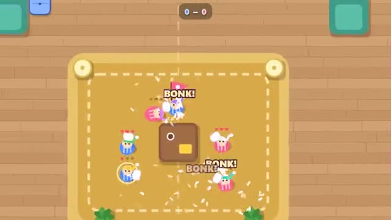

# Pillow Fort War

Build a pillow fort. Then pillow fight for the flag. A multiplayer starter game from [Multiplayer Agent](https://multiplayeragent.com): 2D, versus, 2–8 players, with bots that fill empty seats.

## How it plays

Two teams pile cushions into forts on their side of the living room, then the pillow fight starts: lob pillows over the forts, bonk the other team, grab their flag and carry it home. Get bonked while carrying it and you drop it.

**Controls:** WASD to move, mouse to aim and click to throw, click to place cushions; on phones, left thumb moves and drag on the right to aim and throw.

## Make it yours in the Game Builder

Open the [Game Builder](https://multiplayeragent.com), choose **Start from a starter game** and pick Pillow Fort War. It opens as version 1 in your studio, ready to play and publish. Then ask for changes, for example:

- Add a giant beanbag that bounces pillows back
- Let each kid carry three pillows and pick them up from the floor
- Turn the lights off so you only see near your flashlight

## Run it yourself

1. Get a free publishable key (`pk_…`) at [multiplayeragent.com](https://multiplayeragent.com).
2. In `index.html`, put it in place of `pk_REPLACE_ME` in the `MP_CONNECT` block.
3. Open `index.html` in a browser. No build step and no server needed.

Without a key it still runs, offline against bots.

## How it is built

- One `index.html`. The comment at the top of the script maps the code and explains the multiplayer.
- **Host-run rules:** The host's browser keeps the forts and the flags; if it leaves, the next player takes over.
- **Live sync:** Every pillow, cushion and kid moves for everyone at once.
- **Bots:** Bots build forts and join the fight until enough people join.
- **Leaderboard:** Pillow points: 5 per flag captured and 1 per bonk.
- `?attract` runs it offline with bots only. The preview video is recorded from it.

## License

MIT.
